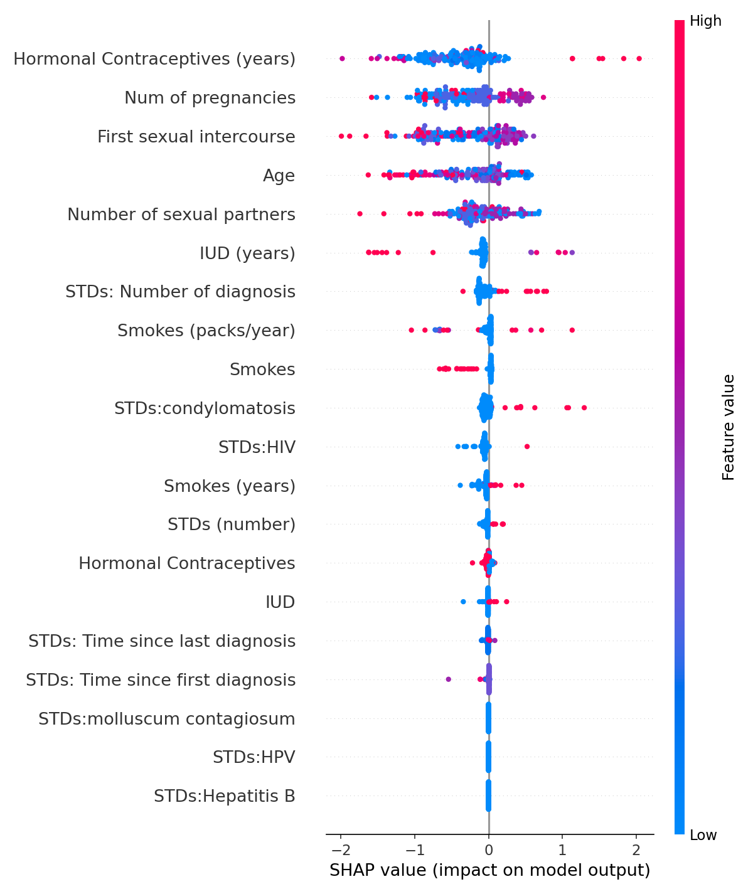

# Cervical Cancer Risk Prediction

Predicts a positive cervical biopsy from patients' demographic, behavioural and medical-history risk factors. It compares an XGBoost classifier with a logistic-regression baseline and a small neural network, evaluates them with repeated cross-validation against a chance-level control, tests a clinically meaningful decision threshold, and uses SHAP values to show which risk factors the model relies on.

Data: the UCI [Cervical Cancer (Risk Factors)](https://archive.ics.uci.edu/dataset/383/cervical+cancer+risk+factors) dataset (Fernandes, Cardoso & Fernandes, 2017), 858 patients.

## Target and features

- **Target: the biopsy result**, the histological diagnostic standard. 55 of 858 patients (6.4%) are positive.
- **Features: 28 risk factors**, such as age, sexual history, pregnancies, smoking, contraceptive use and STD history.
- **Excluded:** the three screening tests (Hinselmann, Schiller, cytology) and the `Dx:*` diagnosis flags. These are other diagnostic results for the same patient, so using them as inputs could leak the answer. Including them makes it easy to report very high accuracy that would not hold for a real screening decision.

## How the evaluation works

With only 55 positive patients, a single 80/20 split leaves about 11 positives in the test set, so one split's score depends heavily on luck. Instead:

- **10× repeated stratified 5-fold cross-validation**, giving 50 test folds.
- **Imputation, scaling and class weighting are fitted on each training fold only**, so nothing from a test fold leaks into training.
- **A shuffled-label control:** the same XGBoost pipeline trained on randomly permuted labels shows what chance looks like.
- **Main metrics are ranking metrics**, ROC AUC and PR AUC, because accuracy is meaningless when 94% of patients are negative.

## Results

| Model (50 test folds) | ROC AUC | Middle 95% of folds | PR AUC | Accuracy (0.5 cutoff) |
|---|---|---|---|---|
| **XGBoost** | **0.61 ± 0.07** | 0.48 to 0.76 | **0.135** | 77.3% |
| Logistic regression | 0.56 ± 0.10 | 0.36 to 0.73 | 0.130 | 75.3% |
| Neural network (32-16 MLP) | 0.48 ± 0.07 | 0.38 to 0.65 | 0.102 | 85.7% |
| Shuffled labels (chance) | 0.50 ± 0.07 | 0.39 to 0.61 | 0.076 | 67.3% |

PR AUC for a random ranking equals the positive rate, 0.064.

Accuracy is reported for completeness but is not used to compare models. Predicting "negative" for every patient scores 93.6% while missing every positive biopsy, and the neural network, which ranks patients no better than chance, has the highest accuracy here.

Comparisons on the same folds:

- **XGBoost vs. chance:** ROC AUC 0.11 higher, and higher in 84% of folds.
- **XGBoost vs. logistic regression:** 0.05 higher, and higher in 76% of folds.
- **XGBoost vs. the neural network:** 0.13 higher, and higher in 90% of folds. With 28 tabular features and 55 positives, the network performs at chance level.

**XGBoost finds a real but modest signal.** These risk factors shift the odds of a positive biopsy, but they are far from a diagnostic test.

### At a screening threshold

A screening tool has to catch most positive cases. Inside each training fold, a cutoff is chosen (using an inner cross-validation) to reach 80% recall, then applied unchanged to the test fold:

| | Mean across 50 folds |
|---|---|
| Recall | 87% |
| Patients flagged | 86% |
| Precision | 6.5% (base rate 6.4%) |
| Accuracy | 19.2% |

**To catch most positive biopsies, the model has to flag almost everyone.** Risk factors alone cannot replace screening tests, and that is the main practical conclusion of this project.

### A shortcut the model found, and why it is not used

Adding "this value was missing" indicators raises ROC AUC to 0.64, higher in 78% of folds. Almost all of that gain comes from one artifact: **none of the 108 patients with no contraceptive history recorded had a positive biopsy** (against 7.3% of everyone else). The model learns that a blank answer means low risk. That reflects how this dataset was collected, not cervical cancer, and it would not hold for new patients. The main model therefore leaves missingness indicators out.

### How we got here

The first version predicted a majority vote of the three screening tests and was evaluated on one 80/20 split, where XGBoost scored ROC AUC 0.66. Repeated cross-validation showed that this was luck of the split: across 50 folds that setup averaged 0.47, no better than chance. Switching the target to the biopsy result is what produced a signal that holds up.

## Interpretability (SHAP)



SHAP values come from XGBoost's built-in TreeSHAP (`pred_contribs=True`). To check that they are stable, they are computed separately in each of the 50 folds, from a model trained on that fold's training data and evaluated on its test data. These factors appear in the top five most often:

| Risk factor | In the SHAP top five |
|---|---|
| Age at first intercourse | 100% of folds |
| Hormonal contraceptives (years) | 100% |
| Age | 100% |
| Number of pregnancies | 96% |
| Any STD history | 72% |

The plot shows the model refit to all patients. A later age at first intercourse lowers predicted risk, while longer hormonal contraceptive use and any STD history raise it. These patterns are consistent with known risk factors in the clinical literature. SHAP describes what the model learned from this data; it does not establish cause.

## Run it

```bash
pip install -r requirements.txt
python train.py
```

This writes `results.json` and `shap_summary.png`. The full UCI dataset (about 100 KB) is included in `data/`.

## Tech stack

Python, XGBoost, scikit-learn, pandas, NumPy, matplotlib
